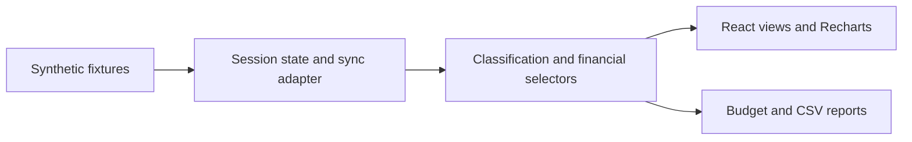

<h1 align="center">Finance Tracker</h1>
<p align="center"><strong>Financial Analytics & Process Automation</strong></p>
<p align="center"></p>
<p align="center"><a href="https://github.com/Saraingridsousa/Finance-tracker/actions/workflows/validate.yml"></a> <a href="https://github.com/Saraingridsousa/Finance-tracker/actions/workflows/deploy-pages.yml"></a></p>
<p align="center"><a href="https://saraingridsousa.github.io/Finance-tracker/"><strong>Explore the live demo</strong></a> · <a href="docs/CASE-STUDY.md">Technical case study</a></p>

## Overview

Finance Tracker transforms fragmented financial information into an interactive analytics experience. This independent portfolio edition uses deterministic fictional data to demonstrate financial classification, automated processing, data integrity and software engineering without accessing real financial accounts.

## Features

| Module | Capabilities |
| --- | --- |
| Overview | BRL income, expenses, period result, contributions, monthly/category charts, search, transaction edits and filters |
| Investments | Six fictional assets, class allocation, historical valuations, gains/losses, sortable positions |
| Cards | Credit limits, open bills, commitments, six-month history, category breakdown and purchase details |
| Planning | Editable budgets, spending alerts, contribution goals, budget-versus-actual chart, CSV reports |
| Connections | Per-source sync, deduplication, processing history and failure recovery simulation |

Light/dark theme, responsive layout, keyboard navigation and resettable in-memory data support interactive exploration.

## Architecture



Financial indicators exclude pending, non-BRL and neutral transactions. A Pix payment alone is not evidence of a self-transfer. Card and investment ledgers are illustrative and independent of the main transaction history. Investment variation is measured against cost, not time-weighted performance.

## Quality and delivery

- Vitest domain regression tests.
- Chromium browser smoke script for navigation, editing, exports, reset, theme and responsive widths.
- Tracked-source privacy guard and npm dependency audit.
- Lazy-loaded views and automated static deployment through GitHub Actions.

See [workflow results](https://github.com/Saraingridsousa/Finance-tracker/actions) for actual validation status. Browser screenshots are generated during the deployment workflow; the case study explains the technical decisions and limits.

## Run locally

Requires Node.js 22.18+ compatible with the lockfile.

```bash
npm ci
npm run dev
npm test
npm run typecheck
npm run build
```

## Privacy and scope

All financial values and institutions are fictional. No real bank API, credentials, personal financial records, persistent storage or private Git history are included. Edits are held in memory and discarded on reload. Never enter real financial information. The application is a technical demonstration, not financial advice or a production banking service.

## Author

Sara Ingrid — software development, process automation and data analytics.
