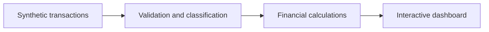

<h1 align="center">Finance Tracker</h1>

Personal finance analytics • Automated classification • Simulated banking integration

## Overview

Finance Tracker is a portfolio project focused on transforming financial transactions into clear, actionable insights through automation, data analysis and software engineering.

**Status: under development.** This repository is being prepared as an independent, synthetic-data demonstration. No live banking connection or public demo is available yet.

## Planned capabilities

- Interactive income, expense and cash-flow dashboards.
- Automated transaction categorization with manual corrections.
- Period filters, category breakdowns and transaction history.
- Simulated synchronization using deterministic fictional banking data.
- Consistent financial rules with automated regression tests.

## Architecture

The planned demonstration will use React and TypeScript, a reusable financial domain layer and a synthetic data adapter. The published application will not require bank credentials, a live financial API or access to personal records.

## Roadmap

- [x] Initialize independent portfolio repository.
- [ ] Review and select reusable, non-sensitive source files.
- [ ] Unify financial calculations and add regression tests.
- [ ] Implement synthetic data fixtures and demo adapter.
- [ ] Validate build, accessibility and responsive layout.
- [ ] Configure continuous integration and publish static demo.

## Privacy

Only fictional financial data may be committed or used in demonstrations. Never commit secrets, personal financial records, database files, real exports or local configuration. The portfolio repository must remain independent of any private financial environment.

## Author

Sara Ingrid — software development, process automation and data analytics.
